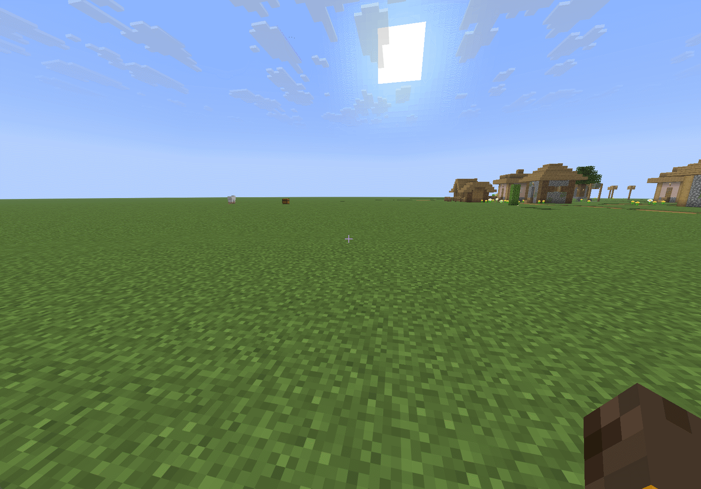
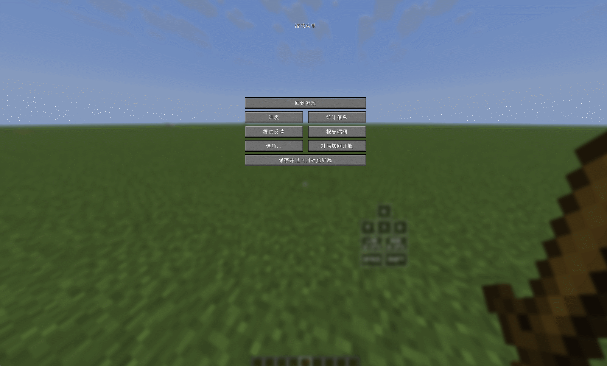
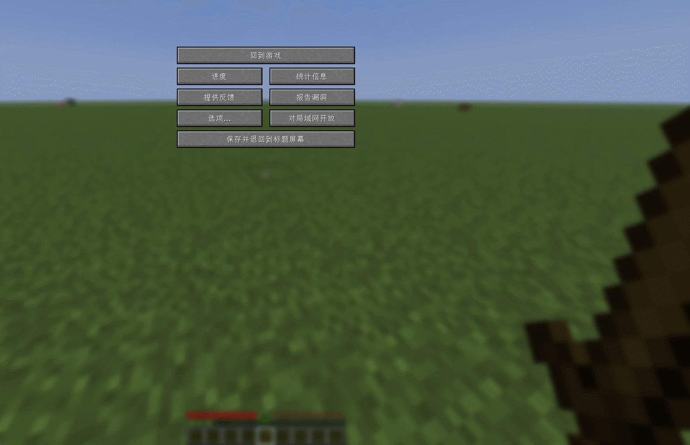
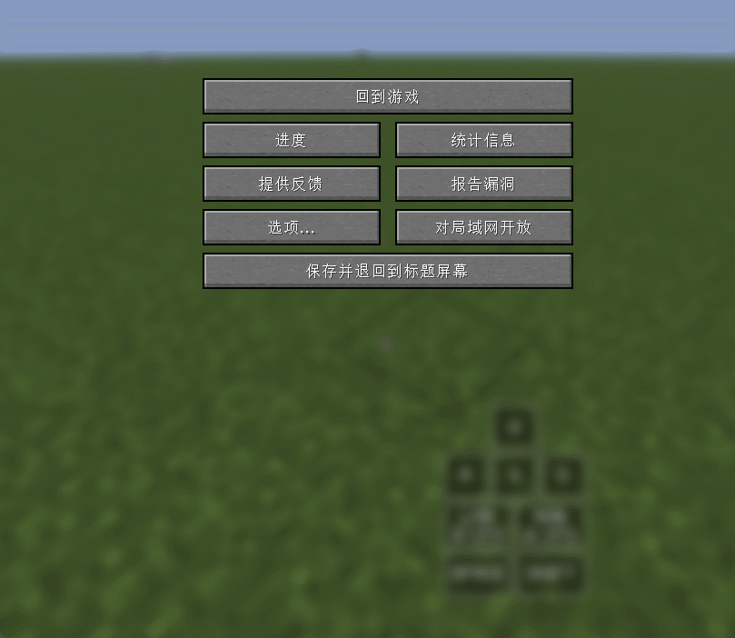

# PVPUtils

  <a href="./README.zh-CN.md"><strong>简体中文</strong></a>

## Introduction

PVPUtils is a utility mod for Minecraft 1.21.11 Fabric. It brings a better experience to PVP, includes useful feature and beautiful visual.

## Features

PVPUtils includes many useful feature for PVP and beautiful visual. The mod groups them into several categories: Combat, Render, Tool, Optimize, Misc, and Theme.
These features include HUD display, block animation, motion blur, input method fixes (for chinese player), block count display, target information display, dymanic island, mouse tweak, zoom, etc. Download mod to see the full features.

## Preview

### Settings UI

### HUD Editor

### Sword Blocking Animation

### Gameplay Utilities

## Purpose

PVPUtils was created to replace other mods and provide a better visual experience

## Notes

PVPUtils also fixes several Minecraft client bugs such as , so you can receive those improvements without installing additional mods.

## Disclaimer

This is a client-side mod. It does not provide server-side data modification or cheating features. Every feature is added after considering compatibility, benefits, and tradeoffs. However, some features may still be considered disallowed by certain servers. Before using the mod, carefully read the rules of the server you play on and confirm that you accept all risks yourself. By using this mod, you are considered to have read and understood the relevant server rules and to accept full responsibility. PVPUtils is not responsible for account bans or other consequences caused by server rule violations.

## FAQ

1. Starting from version 1.1, the mod requires Windows 10 or later and the Visual C++ Redistributable runtime. Mobile devices and systems older than Windows 10 are not supported. Use versions earlier than 1.1 if needed.
2. The settings UI and HUD depend on GPU rendering. Smooth performance is not guaranteed on low-end devices, and future versions will continue to optimize performance.
3. The default keybind is `Right Shift`. There is also a settings button in the top-right corner of the inventory screen.
4. Press `P` on the title screen to switch to the custom main UI. Click the title in the top-left corner to return to the vanilla UI, and right-click it to switch UI styles. Low-end devices may stutter during switching; this is normal.
5. Language switching is located under `Misc -> Language Switch`. Right-click to expand it and switch between Chinese and English. Reopen the UI for the change to take effect.
6. This mod is currently not compatible with Lunar Client. Other third-party clients haven't been fully tested yet and might have issues.
7. Target health display may occasionally be inaccurate. This is usually caused by server plugin restrictions and cannot be fixed by the mod.

## License

This project uses the PVPUtils Source-Available Non-Commercial License. Commercial use is not permitted. Derivative works must remain source-available, must credit Nachoneko_miao and PVPUtils contributors, and must clearly document which parts of PVPUtils were used or modified. See [LICENSE](./LICENSE) for the full text.
