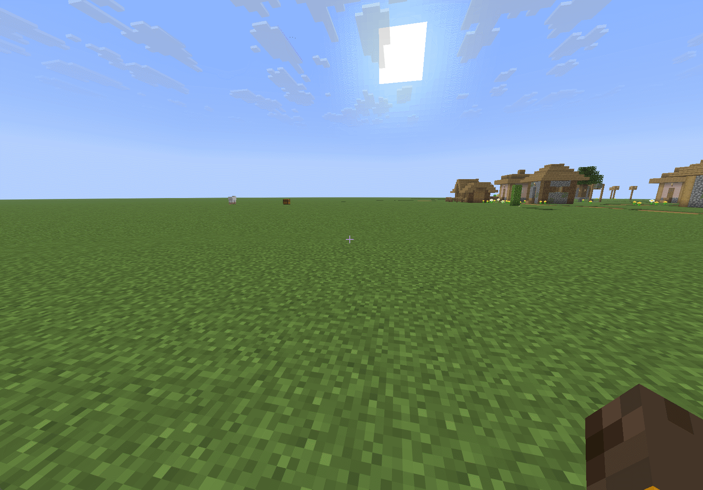
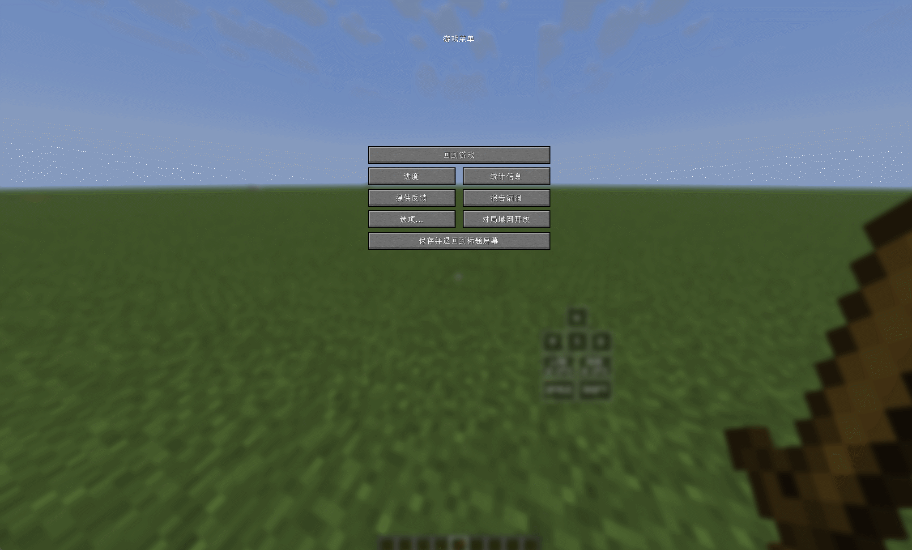
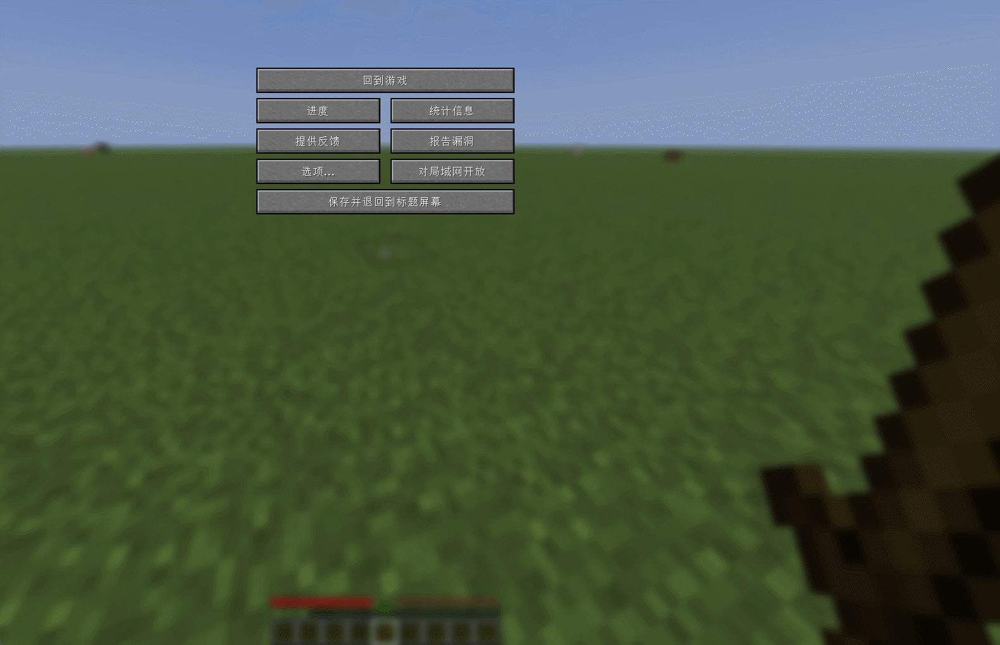
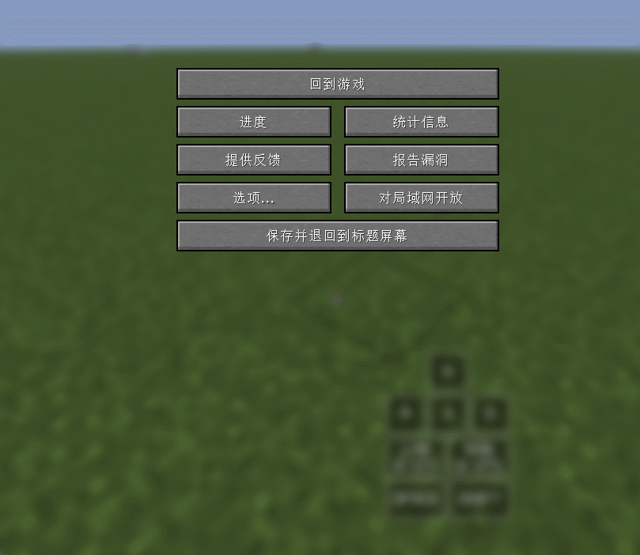

# PVPUtils

  <a href="./README.md"><strong>English</strong></a>

## 简介

PVPUtils 是一个适用于 Minecraft 1.21.11 Fabric 的实用模组。它为 PVP 带来更好的体验，包含实用功能和精美的视觉效果。

## 功能

PVPUtils 包含许多适用于 PVP 的实用功能和精美的视觉效果。模组将这些功能分为几个类别：战斗、渲染、工具、优化、杂项和主题。
这些功能包括 HUD 显示、方块动画、动态模糊、输入法修复（面向中文玩家）、方块数量显示、目标信息显示、动态岛、鼠标调整、缩放等。下载模组即可查看完整功能。

## 预览

### 设置界面

### HUD 编辑器

### 剑格挡动画

### 游戏实用功能

## 免责声明

PVPUtils 是一个客户端模组，不会修改服务器数据，也不提供作弊功能。一些服务器仍可能禁止使用它，因此请在使用前阅读其规则，并自行承担所有风险。

## 常见问题
1. 默认快捷键是 `右 Shift`。
2. 在标题界面按 `P` 可切换到自定义标题界面。
3. 语言切换位于 `杂项 -> 语言切换`。右键展开它，并在中文和英文之间切换。重新打开界面后更改才会生效。
4. 本模组目前不兼容 Lunar Client。其他第三方客户端尚未完全测试，可能会存在问题。
5. 目标生命值显示偶尔可能不准确。这通常是由服务器插件限制导致的，模组无法修复。

## 许可证

本项目使用 PVPUtils Source-Available Non-Commercial License。不允许商业使用。衍生作品必须保持源码可见，必须注明 Nachoneko_miao 和 PVPUtils 贡献者，并清楚记录使用了或修改了 PVPUtils 的哪些部分。完整文本见 [LICENSE](./LICENSE)。
